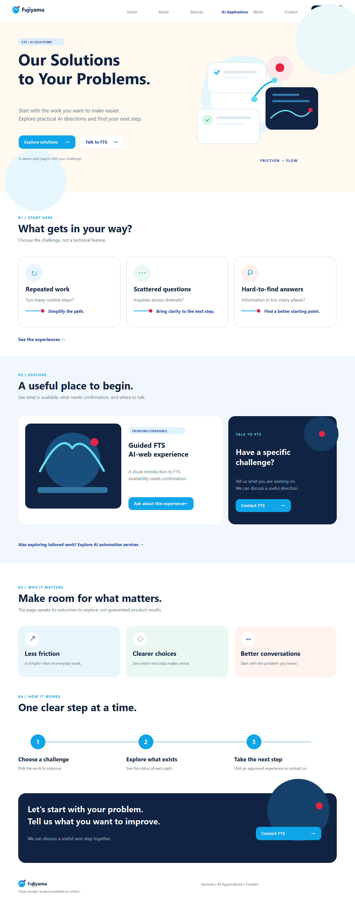
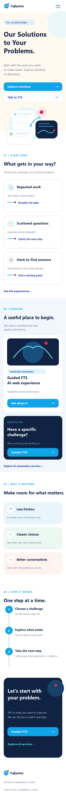
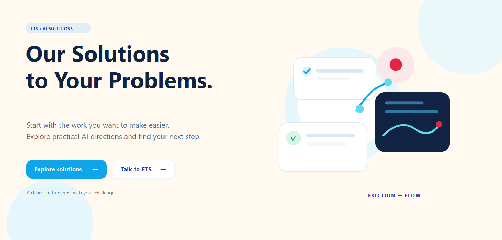
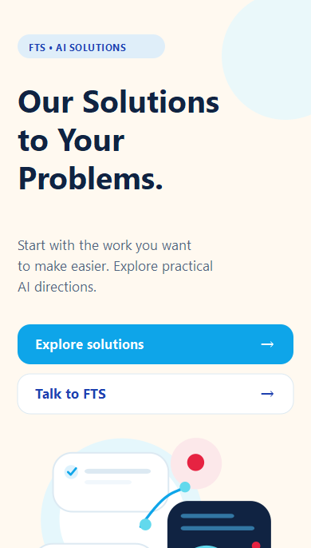
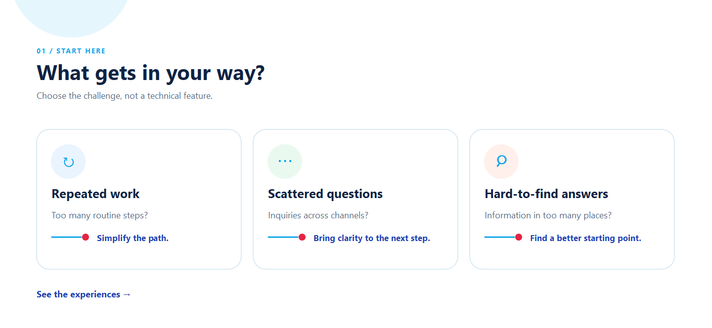
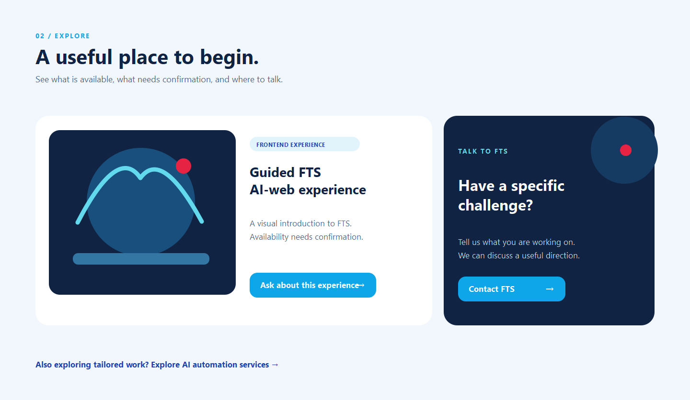
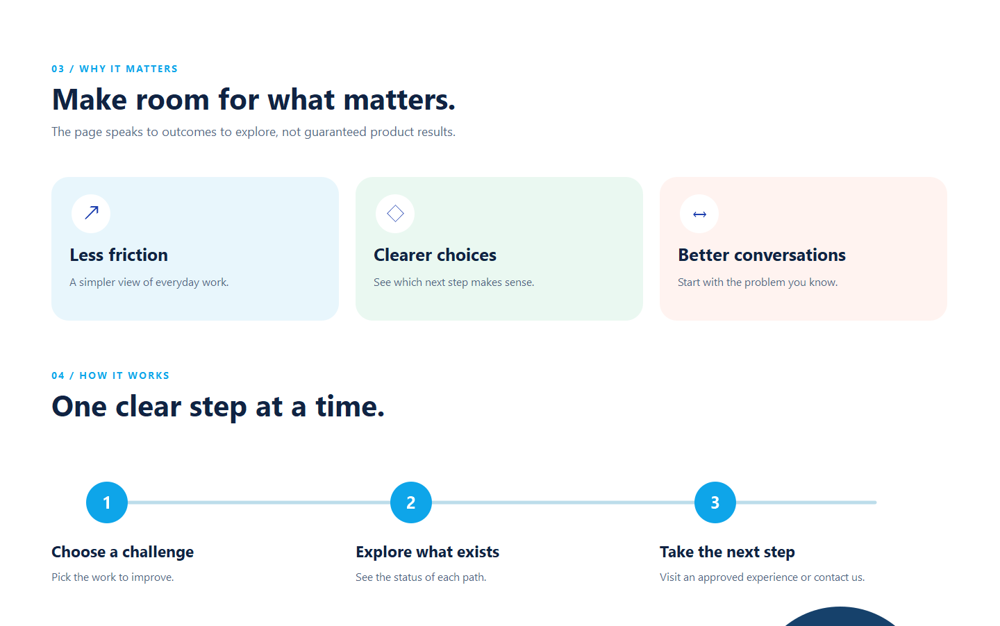

# Proposal Desain Visual FTS AI Landing Page

**Untuk review Mr. Yoshi · Handoff implementasi Mr. Miftah**  
**Konsep:** From Friction to Flow, dengan gaya editorial yang lebih ramah dan playful  
**Pesan utama:** Our Solutions to Your Problems  
**Dasar repository:** `Company-Profile-FE` · `main` · `4ffb199f6889b32fe15181f7c3c92939283ece7b` · 12 November 2026

> **Status visual:** gambar-gambar berikut adalah mockup halaman yang benar-benar dikomposisikan, bukan screenshot situs yang sudah tayang. Navigasi, preview aplikasi dan microcopy masih usulan; status produk dan URL live perlu persetujuan pemilik.

## Bagian A — Proposal visual / Mr. Yoshi

### Ringkasan eksekutif dan tujuan

Halaman ini memperkenalkan penawaran AI FTS melalui cerita yang berangkat dari kebutuhan pelanggan. Pengunjung—pemilik bisnis, perusahaan, profesional, atau individu—diajak mengenali masalah, memahami arah solusi, lalu memilih antara **pengalaman yang sudah disetujui** dan **menghubungi FTS**. Tidak ada satu aplikasi yang dijadikan pusat halaman. Konsep lama **From Friction to Flow** dipertahankan, tetapi diolah menjadi kartu ringan seperti potongan kertas, garis sirkuit bercabang, titik merah kecil, dan siluet Fuji yang lebih ramah. Kejernihan modern SaaS bertemu estetika Jepang yang terukur dan warna khas FTS.

Copy yang tampil di website menggunakan bahasa Inggris agar selaras dengan situs saat ini. Mockup bukan janji kemampuan AI, hasil bisnis, atau demo publik. Halaman layanan AI yang ada tetap terpisah. Jika belum ada aplikasi yang disetujui untuk dicoba publik, **kontak FTS** adalah tujuan konversi yang paling jujur.

### Moodboard dan identitas visual

| Lapisan | Arah | Hindari |
|---|---|---|
| Komposisi | Hero krem yang lega, bidang baca putih, showcase biru kabut, CTA navy; lingkaran asimetris | Grid kartu korporat monoton di semua section |
| Storytelling | Fragmen masalah bergabung menjadi jalur lebih jelas; garis biru pendek dan node merah | Robot, otak bercahaya, grafik angka palsu, orb 3D generik |
| Karakter | Kartu editorial membulat, sentuhan kontur Fuji/sirkuit, satu aksen merah | Mengganti logo resmi atau ornamen Jepang yang berlebihan |
| Foto/UI | Screenshot aplikasi asli yang disetujui bila ada; tanpa stok foto orang generik | Antarmuka rekaan yang seolah menunjukkan fitur aktif |

**Palet:** token yang sudah ada di `src/index.css` ialah primary `#0EA5E9`, primary-light `#3B82F6`, primary-dark `#1E40AF`. Logo `/Logo FTS.webp` menunjukkan Fuji/sirkuit biru dan lingkaran merah. Warna khusus usulan halaman: navy `#102342`, krem `#FFF9F0`, mist `#F1F7FC`, cyan muda `#62D9ED`. Merah hanyalah aksen kecil, bukan token resmi baru; jangan pakai cyan sebagai teks kecil di putih. Saat implementasi, sesuaikan dengan token tema terang/gelap.

**Tipografi:** Inter untuk seluruh UI. Usulan desktop H1 56–64 px, H2 36–44 px, body 17–19 px; mobile H1 36–40 px, H2 26–30 px, body 15–17 px; line height 1,5–1,65. Font Fraunces dan Petit Formal Script sudah dimuat untuk konteks editorial lain, tetapi tidak wajib di halaman ini. **Badge gunung kecil dalam mockup hanyalah placeholder konseptual**; implementasi memakai logo resmi FTS.

### Mockup desktop — satu halaman utuh

Alur: navigasi → hero → tiga tantangan pelanggan → pengalaman dan kontak → manfaat konseptual → tiga langkah → CTA akhir → footer. Kartu pengalaman hanya menunjukkan **pola presentasi**, bukan daftar lengkap produk FTS. Jumlah kartu mengikuti inventaris aplikasi yang disetujui; tidak ada produk rekaan untuk mengisi ruang. Kartu kontak gelap diberi bobot setara agar halaman tidak berpusat pada satu aplikasi.

### Mockup mobile — tata letak responsif nyata

Pada lebar 390 px, judul dibagi menjadi tiga baris, CTA hero menjadi selebar kolom, kartu ditumpuk, status terlihat sebelum tombol, langkah-langkah berubah vertikal, dan CTA penutup tetap jelas. Ikon hamburger mengikuti pola navigasi situs. Dalam PDF, potongan mobile diperbesar agar mudah diperiksa.

### Konsep hero — identitas visual halaman

**Headline:** Our Solutions to Your Problems.  
**Deskripsi:** Start with the work you want to make easier. Explore practical AI directions and find your next step.  
**CTA utama:** Explore solutions → `#solutions`.  
**CTA kedua:** Talk to FTS → `/contact`.

Dua kartu editorial mengambang dan satu panel navy menggambarkan *tantangan → arah yang tertata*. Garis di panel hanyalah placeholder, **bukan** fitur produk atau jawaban AI. Titik merah menjadi fokus yang ceria namun tidak ramai. Hero adalah ilustrasi desain, bukan screenshot. Versi implementasi sebaiknya SVG buatan desainer dengan fallback statis.

### Visual pendukung dan struktur halaman

| Section / tujuan | Copy website dan aksi | Spesifikasi visual/layout |
|---|---|---|
| **Hero** — orientasi | “Our Solutions to Your Problems.” / “Explore solutions” / “Talk to FTS” | Desktop 55/45: teks kiri, ilustrasi kanan; mobile teks dan CTA dahulu |
| **Tantangan** — relevansi | “What gets in your way?” / “Choose the challenge, not a technical feature.” / “See the experiences” | Tiga kartu masalah→pendekatan di desktop; satu kolom mobile |
| **Pengalaman** — jalur jujur | “A useful place to begin.” / “See what is available, what needs confirmation, and where to talk.” / “Ask about this experience” | Contoh frontend yang teramati (`/fts-aiweb/`) dengan label **availability needs confirmation**; tidak ada tautan otomatis “Try AI” |
| **Kontak** — konversi | “Have a specific challenge?” / “Tell us what you are working on.” / “Contact FTS” | Kartu navy setara di desktop, ditumpuk di mobile; menuju `/contact` |
| **Manfaat** — niat desain | “Make room for what matters.” / “Less friction” / “Clearer choices” / “Better conversations” | Tiga kartu editorial, bukan klaim performa terukur |
| **Langkah** — mengurangi keraguan | “One clear step at a time.” / “Choose a challenge” / “Explore what exists” / “Take the next step” | Garis horizontal desktop, vertikal mobile; label berupa HTML |
| **Penutup** — aksi | “Let's start with your problem.” / “Contact FTS” / “Explore AI services” | Panel navy; `/contact` dan `/ai-automation-indonesia`, tanpa formulir duplikat |

**Kejujuran visual:** artwork di kartu “Guided FTS AI-web experience” adalah **konsep**, bukan tangkapan layar asli atau bukti percakapan AI bekerja. Saat implementasi, ganti dengan capture berizin atau beri label konsep. CTA “Ask about this experience” menuju `/contact` sampai QA dan persetujuan `/fts-aiweb/`. Brief menyebut myAI demo UI dengan AI belum aktif; aplikasi itu sengaja tidak diunggulkan. Jika kelak ditambahkan, beri label **“UI demo · AI features not active”** dan hanya gunakan URL demo/kontak yang telah disetujui.

## Bagian B — Handoff developer / Mr. Miftah

### Temuan repository

Frontend memakai Vite 5, React 18, TypeScript SPA (`package.json`, `src/main.tsx`, `src/App.tsx`), React Router dengan lazy pages dan metadata SEO. UI menggunakan Tailwind 3, token HSL `src/index.css`, shadcn/Radix, Lucide, dan Framer Motion. `Navigation`, `Footer`, tombol, dukungan tema, dan menu responsive sudah tersedia. Halaman `/ai-automation-indonesia` memakai container `max-w-6xl`/`px-4` dan CTA kontak; itu halaman **layanan**, bukan katalog aplikasi. `/contact` sudah menyediakan pilihan kontak.

`public/fts-aiweb/` adalah frontend HTML/CSS/JS statis yang terpisah. `src/flow.js` memanggil `src/conversationAdapter.js` untuk teks bebas; `config.js` mengatur endpoint pengunjung. Namun konektivitas produksi dan perilaku AI **belum diuji**. Beberapa jalur konten/bridge merupakan placeholder. Tidak ditemukan route atau implementasi `myAI` di `src/`/`public/` yang terlacak; status demo berasal dari brief. `index.html` memuat Inter dan font editorial; aset resmi `/Logo FTS.webp`. `npm run build` mendahului Vite dengan `scripts/version-aiweb.mjs`; build tidak dijalankan pada pekerjaan proposal ini. Jangan gunakan layout adegan AI-web yang fixed sebagai shell landing baru.

### Token dan komponen

| Kelompok | Nilai usulan | Hubungan dengan project |
|---|---|---|
| Biru utama | `hsl(var(--primary))` (~`#0EA5E9`) | Token existing; cek kontras teks tombol |
| Biru tua | `hsl(var(--primary-dark))` (~`#1E40AF`) | Token existing |
| Navy halaman | `#102342` konsep | Bidang lokal, bukan perintah mengubah token global |
| Krem/mist | `#FFF9F0` / `#F1F7FC` | Latar lokal; adaptasi dark mode |
| Jarak | Basis 8 px; 16/24/32/48/72/96 px | Mengikuti ritme Tailwind |
| Container | `max-w-6xl`, `px-4` | Pola halaman AI saat ini; canvas mockup 1440 px berjarak 74 px dari tepi |
| Kartu | Radius konsep 24–28 px, border terang 1–2 px | Selaraskan dengan `--radius: 0.75rem`; jangan ubah global |
| Tombol | Biru utama, teks putih+panah; varian putih/outline; tinggi ~50–54 px | Pakai Button existing; cek focus/kontras pada kedua tema |
| Ikon/motion | Lucide 20–28 px; hover naik 2–4 px, reveal 300–500 ms | Tidak perlu library 3D baru |

Badge logo dan label navigasi di mockup hanya ilustratif. Produksi wajib memakai logo resmi, pola navigasi existing, theme toggle dan tautan resmi. Komponen baru seperti `ChallengeCard`, `ExperienceCard`, `StepFlow` dibuat hanya bila pola berulang; jangan tambah library UI.

### Responsive dan interaksi

| Area | Desktop ≥1024 px | Tablet 640–1023 px | Mobile <640 px |
|---|---|---|---|
| Hero | Split 55/45; tinggi mengikuti isi | Persempit/tumpuk sebelum bertabrakan | Teks → dua CTA lebar penuh → ilustrasi |
| Tantangan | Tiga kartu, gap ~24 px | Dua lalu satu jika cukup | Satu kolom; masalah di atas pendekatan |
| Pengalaman/kontak | Dua kolom seimbang | Satu/dua sesuai isi nyata | Satu kolom; status selalu terlihat |
| Manfaat | Tiga tile setara | Dua lalu satu | Ditumpuk sesuai urutan baca |
| Langkah | Tiga node horizontal | Beralih ke vertikal sebelum sesak | Garis vertikal dan label HTML yang dapat dipilih |
| Penutup | Copy kiri/CTA kanan | Wrap/tumpuk | Tombol selebar kolom; sentuh ≥44 px |

Anchor `#solutions` dan `#experiences` memerlukan offset header sticky. Route internal memakai React Router; `/fts-aiweb/` adalah tujuan statis yang perlu QA routing produksi. Jangan tautkan aplikasi eksternal yang belum disetujui. Status harus berupa teks terlihat dan semantik aksesibel, tidak hanya warna atau hover. Di dark mode, adaptasi krem/mist dan cek rasio kontras teks normal ≥4,5:1. Hormati `prefers-reduced-motion`: semua konten dan tombol tetap terlihat. Periksa focus keyboard, overflow 320 px, breakpoint tablet, dan panjang konten nyata. Analytics CTA harus mendapat persetujuan privacy/owner.

### Daftar aset dan organisasi

Aset mockup **sudah benar-benar dibuat** di `assets/`; PNG yang digunakan tertanam di DOCX dan PDF. Dua SVG halaman penuh merupakan komposisi presentasi yang dapat diedit, bukan komponen React siap produksi.

| Aset | Tujuan | Ukuran / rasio | Catatan produksi |
|---|---|---|---|
| `desktop-full.png` + `.svg` | Konsep desktop utuh | 1440×3630 (~0,40:1) | Tinjau full-size; crop section disediakan |
| `mobile-full.png` + `.svg` | Konsep mobile utuh | 390×4660 (~0,084:1) | Halaman panjang; uji implementasi juga pada 320 px |
| `hero-desktop.png` | Hero | 1440×690 (~2,09:1) | Dekorasi SVG, teks sebagai HTML |
| `hero-mobile.png` | Hero mobile | 390×686 (~0,57:1) | Pertahankan urutan teks sebelum ilustrasi |
| `problems-desktop.png` | Kartu tantangan | 1440×664 (~2,17:1) | Ikon dapat memakai Lucide |
| `showcase-desktop.png`, `showcase-mobile.png` | Pengalaman/kontak | 1440×836 dan 390×1008 | Ganti artwork konsep dengan screenshot asli berizin atau label konsep |
| `benefits-steps.png` | Manfaat/langkah | 1440×902 (~1,60:1) | Langkah berupa HTML semantik, connector dekoratif |

**Usulan direktori implementasi setelah persetujuan:** `public/images/ai-landing/`; nama `hero-flow.svg`, `challenge-*.svg`, `experience-*.webp`, `step-connector.svg`. SVG untuk line art, WebP teroptimasi untuk screenshot asli. Resolusi screenshot lebar sekitar 1280×720 atau 1600×900 bila memang diperlukan 2× ukuran tampilan. Ilustrasi bermakna perlu alt deskriptif, ornamen alt kosong. Jangan menanam teks AI rekaan, metrik, atau logo palsu di gambar.

### Prioritas dan gerbang persetujuan

1. **P0 persetujuan konten:** Mr. Yoshi/pemilik produk memastikan inventaris, kesiapan, hak screenshot, URL/CTA; bila myAI ditampilkan, label demo UI dan AI belum aktif.
2. **P1 persetujuan visual:** sepakati desktop/mobile, navy/krem, logo resmi, gaya ilustrasi, dan dark mode. Setujui gambar asli sebelum export produksi.
3. **P1 fondasi halaman oleh Miftah:** route lazy/SEO kelak, Navigation/Footer existing, section HTML semantik, token tema dan layout statis. Dokumen ini tidak mengimplementasikannya.
4. **P2 pemolesan:** responsive, hover/focus, status aksesibel, reduced-motion, visual asli teroptimasi.
5. **P0 QA publikasi:** cek tautan/klaim, endpoint dan route bila CTA aplikasi digunakan, 320/390/768/1440 px, kontras, hak gambar dan privasi.

**Kriteria penerimaan:** pengunjung dapat membedakan layanan, frontend experience dan UI demo; halaman mewakili FTS secara luas, bukan satu aplikasi; CTA valid; hierarki desktop/mobile mengikuti mockup; tidak ada klaim melebihi bukti. Proposal tidak mengubah source, config atau dependency.

### Kesimpulan dan yang belum disetujui

Desain ini memadukan biru FTS dengan cerita *friction-to-flow* yang fun namun tetap jujur. Visual siap untuk **review**, belum untuk publikasi. Masih perlu konfirmasi nama/inventaris produk, akses demo myAI, perilaku endpoint/deployment AI-web, hak screenshot, route final, URL aplikasi, dan copy akhir. Mockup adalah artefak desain, bukan hasil uji frontend.
