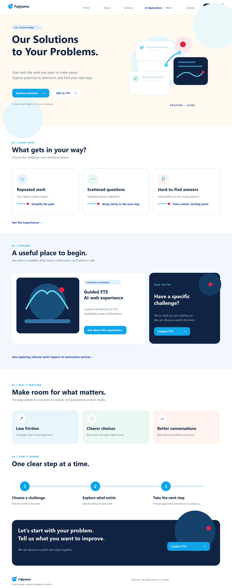
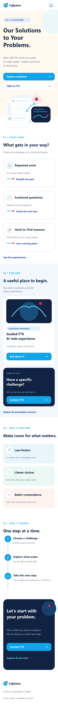
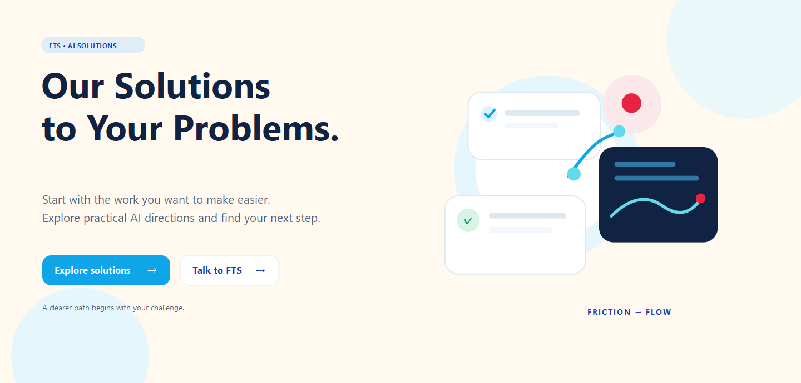
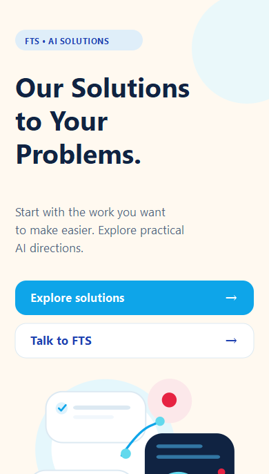
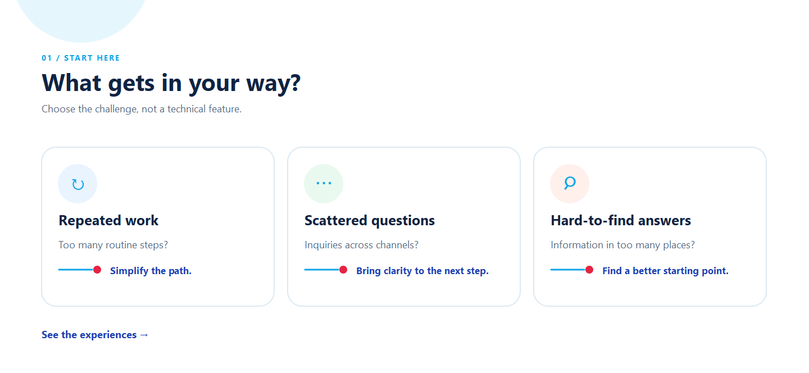
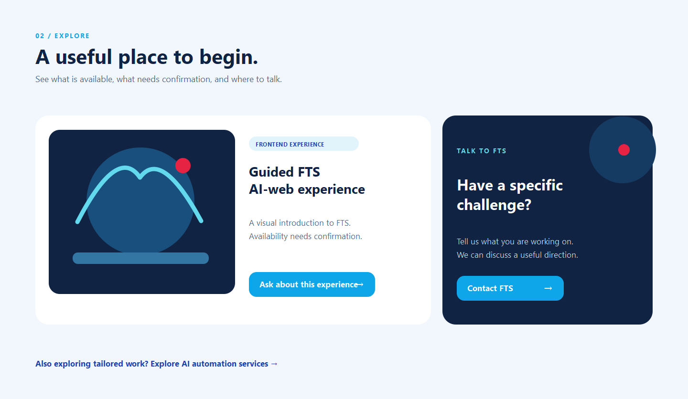
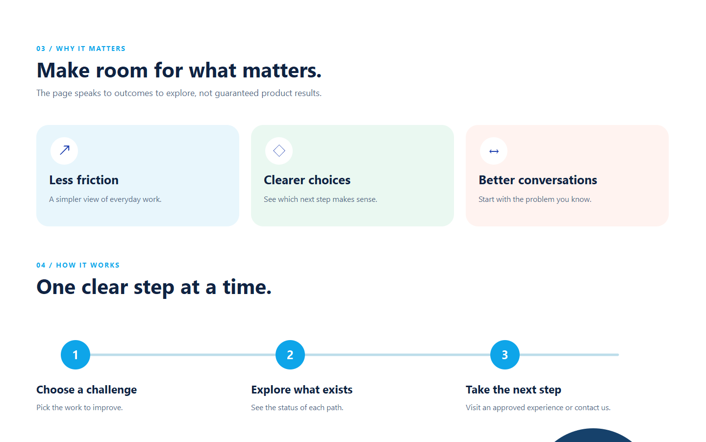

# FTS AI Landing Page — Visual Design Proposal

**Review for Mr. Yoshi · Implementation handoff for Mr. Miftah**  
**Design concept:** From Friction to Flow, reimagined as a playful editorial journey  
**Main message:** Our Solutions to Your Problems  
**Repository baseline:** `Company-Profile-FE` · `main` · `4ffb199f6889b32fe15181f7c3c92939283ece7b` · 12 November 2026

> **Visual status:** The images below are actual *composed landing-page mockups*, not screenshots of a deployed page. Navigation placement, app preview, and microcopy are proposed. Application status and live links require owner approval.

## Part A — Visual design proposal / Mr. Yoshi

### 1. Executive summary and objective

The page introduces FTS's AI offering through a customer-first story. It welcomes business owners, teams, professionals, and individuals without making any one application the hero. Visitors should see a familiar challenge, understand a useful direction, then choose between an **approved experience** and **talking to FTS**. The concept keeps the earlier **From Friction to Flow** idea but gives it a more inviting form: paper-like cards, a branching circuit line, a small red accent and curved Fuji-inspired silhouettes. It is contemporary SaaS in clarity, Japanese-rooted in restraint, and unmistakably FTS in blue, navy and mountain/circuit references.

The display copy is English, matching the site's current language. This is a visual proposal—not a promise of working AI, measurable outcomes or a public demo. The existing AI service page remains a separate route. If no experience is approved for public use, **contact** remains the honest primary conversion path.

### 2. Visual moodboard — the feeling, not stock imagery

| Layer | Direction | Avoid |
|---|---|---|
| Composition | Airy cream hero, white reading areas, mist-blue showcase, navy invitation; soft asymmetric circular shapes | Every section looking like the same corporate card grid |
| Story | Small pieces move from confusion to a clearer path; visual continuity through short blue line + red node | Glowing brain, robot, fake data graphs, giant 3D orb |
| Character | Rounded editorial vector cards, restrained Fuji ridge/circuit detail, one unexpected red dot | Literal replacement of the official logo or ornate Japanese clichés |
| Photography/UI | No generic people stock photo; real, approved app screenshot only when available | Invented functionality inside persuasive screenshots |

**Color palette.** Existing tokens from `src/index.css`: bright primary `#0EA5E9`, primary-light `#3B82F6`, primary-dark `#1E40AF`; the logo in `public/Logo FTS.webp` has blue Fuji/circuit artwork and a red circle. Proposed page-only surfaces: navy `#102342`, cream `#FFF9F0`, mist `#F1F7FC`, light cyan `#62D9ED`. Red is a tiny accent sampled visually from the official mark, not a new official brand token. Never use cyan alone as small text on white. Respect light and dark theme variables when implemented.

**Typography.** Inter is loaded in `index.html` and is appropriate for all UI text. Proposed sizes: desktop H1 56–64 px, H2 36–44 px, body 17–19 px; mobile H1 36–40 px, H2 26–30 px, body 15–17 px. Body line height 1.5–1.65; short paragraphs and a readable width. Fraunces and Petit Formal Script are also loaded for editorial contexts elsewhere, but are not necessary for this application page. Use the *official* logo as the final nav asset; the tiny mountain badge in the mockup is a conceptual placeholder, not a replacement artwork.

### 3. Desktop full-page mockup — review at native resolution

**Reading order:** navigation → hero → three customer challenges → experience and contact paths → outcome-oriented benefits → three simple steps → final contact CTA → footer. The single featured frontend example illustrates the *card pattern*, not the complete FTS product inventory. Card quantity is determined by owner-approved applications; no fictitious products fill empty slots. The dark companion contact card has equal weight so the page does not revolve around one app.

### 4. Mobile full-page mockup — responsive layout, not a scaled desktop

At 390 px, the heading wraps into three deliberate lines, both hero actions are full width, cards become one column, status precedes the experience CTA, steps form a vertical line, and the closing actions stay reachable. The hamburger represents the existing menu pattern. The mobile image is tall by design; the PDF below includes enlarged section crops for readable review.

### 5. Hero concept — the signature visual

**Headline:** Our Solutions to Your Problems.  
**Description:** Start with the work you want to make easier. Explore practical AI directions and find your next step.  
**Primary CTA:** Explore solutions → `#solutions`.  
**Secondary CTA:** Talk to FTS → `/contact`.

Two small floating editorial cards and one navy trajectory panel stand for *challenge → organized direction*. The illustration deliberately contains placeholder bars, **not** generated app features or an AI answer. The red dot provides a cheerful focal point without adding visual noise. Hero is a design illustration, not a product screenshot. A production version should use hand-authored SVG with a static fallback.

### 6. Supporting visuals and page structure

| Section / purpose | Visitor-facing copy and action | Visual/layout specification |
|---|---|---|
| **Hero** — orient and motivate | “Our Solutions to Your Problems.” / “Explore solutions” / “Talk to FTS” | Two-column 55/45 desktop; headline left, vector flow right; mobile copy and CTAs first |
| **Challenges** — help self-identification | “What gets in your way?” / “Choose the challenge, not a technical feature.” / “See the experiences” | Three short challenge→approach cards desktop; stacked mobile; three abstract icons |
| **Experience** — show an honest path | “A useful place to begin.” / “See what is available, what needs confirmation, and where to talk.” / “Ask about this experience” | One example of an observed frontend (`/fts-aiweb/`) with **availability needs confirmation**; approved product inventory may change; no automatic “Try AI” link |
| **Contact route** — convert without a ready app | “Have a specific challenge?” / “Tell us what you are working on.” / “Contact FTS” | Navy card paired with experience desktop, stacked beneath it mobile; action `/contact` |
| **Benefits** — explain design intent | “Make room for what matters.” / “Less friction” / “Clearer choices” / “Better conversations” | Three colored editorial cards; aspirational framing, **not** verified product performance |
| **Steps** — remove uncertainty | “One clear step at a time.” / “Choose a challenge” / “Explore what exists” / “Take the next step” | Horizontal line desktop, vertical mobile; labels remain HTML |
| **Closing** — offer a next move | “Let's start with your problem.” / “Contact FTS” / “Explore AI services” | Navy panel, no duplicate form; use `/contact` and `/ai-automation-indonesia` |

**Truthfulness note.** The mockup's navy artwork inside “Guided FTS AI-web experience” is a **conceptual visual**, not an actual screenshot or proof of a working AI conversation. In the implementation, replace it with an approved real capture or label the concept art clearly. Its “Ask about this experience” link points to `/contact` until QA and owner approval of `/fts-aiweb/`. The brief says myAI is a UI demo with AI inactive; it is deliberately not featured here. If listed later, show **“UI demo · AI features not active”** and an approved contact/demo route. Never imply live AI capability from the card's illustration.

## Part B — Developer design handoff / Mr. Miftah

### 7. Evidence from the existing repository

The frontend is a Vite 5 / React 18 / TypeScript SPA (`package.json`, `src/main.tsx`, `src/App.tsx`) with React Router lazy pages and SEO metadata. It uses Tailwind 3, HSL color tokens in `src/index.css`, shadcn/Radix UI, Lucide icons and Framer Motion. The site already supplies `Navigation`, `Footer`, buttons, theme support, and a responsive menu (`src/components/Navigation.tsx`). The AI service page at `/ai-automation-indonesia` uses readable containers (`max-w-6xl`, `px-4`) and contact links; it is not an applications catalogue. `/contact` provides existing contact options.

`public/fts-aiweb/` is a **separate static** scene-based frontend (HTML/CSS/JS), not a React route. Its `src/flow.js` calls `src/conversationAdapter.js` for free-text responses; `config.js` sets a visitor endpoint, but production reachability and actual AI behavior were **not tested**. Some local content/bridge paths are placeholders. No `myAI` implementation or route was found in tracked `src/` or `public/`; the demo status is supplied by the brief. The existing site loads Inter and editorial fonts from Google Fonts in `index.html`; the brand asset is `/Logo FTS.webp`. `npm run build` runs `scripts/version-aiweb.mjs` first; this proposal did not run a build. Do not use the AI-web's fixed scene layout as the new landing-page shell.

### 8. Design tokens and components

| Token/group | Suggested implementation value | Existing relationship |
|---|---|---|
| Core blue | `hsl(var(--primary))` (~`#0EA5E9`) | Existing CSS token; use for accents/CTAs subject to text contrast |
| Deeper blue | `hsl(var(--primary-dark))` (~`#1E40AF`) | Existing token; focus/strong contrast |
| Page navy | `#102342` in concept; align with theme if needed | Proposed local surface, not a global token mandate |
| Cream/mist | `#FFF9F0` / `#F1F7FC` | Proposed page-only backgrounds; adapt for dark mode |
| Spacing | 8 px base; 16/24/32/48/72/96 px | Consistent with existing Tailwind rhythm |
| Container | `max-w-6xl`, `px-4` baseline | Matches current AI page; mockup uses 74 px side at 1440 canvas |
| Card | 24–28 px concept radius, light 1–2 px border | Reconcile with existing `--radius: 0.75rem`; don't change global radius |
| Button | Primary bright blue with white label and arrow; secondary white/outlined; ~50–54 px high | Use existing Button component; check contrast and focus on both themes |
| Icons/motion | Lucide 20–28 px; optional 2–4 px hover lift, 300–500 ms reveal | Reuse installed packages; no new 3D dependency |

The mockup's simplified logo badge and header labels are **illustrative**. Production must use the official logo and existing nav patterns, including theme toggle and all approved existing links. Any new component (`ChallengeCard`, `ExperienceCard`, `StepFlow`) should be extracted only if it genuinely repeats; do not introduce another UI library.

### 9. Responsive and interaction specification

| Area | Desktop ≥1024 px | Tablet 640–1023 px | Mobile <640 px |
|---|---|---|---|
| Hero | 55/45 split, diagram on right; content-driven height | Shrink split or stack before overlap | Text → two full-width CTAs → image; no essential crop |
| Challenges | 3 cards, ~24 px gap | 2 then 1 if comfortable | 1 column; challenge above solution |
| Experience/contact | 2 visually balanced columns; experience media at left | 1 or 2 based on real text width | 1 column; status visible without hover |
| Benefits | 3 equal editorial tiles | 2 then 1 | Stack in reading order |
| Steps | 3 connected nodes across | Switch vertical early | Vertical line and selectable HTML labels |
| Closing | Copy left / CTA right | Wrap or stack | CTA full-width; ≥44 px touch target |

`#solutions` and `#experiences` anchors need sticky-header offset. Internal routes use React Router links. `/fts-aiweb/` is a separate static destination and needs production routing verification before use. No link to unapproved external apps. Show status in visible text and accessible semantics—not only color or hover. In dark mode, swap cream/mist surfaces to compatible tokens and recheck normal text ≥4.5:1. Respect `prefers-reduced-motion`: no animation-dependent content; keep all cards, status and CTAs visible. Confirm keyboard focus, 320 px overflow, tablet breakpoints and real content lengths. Do not enable analytics events without privacy/owner approval.

### 10. Asset delivery list

The following **actual mockup files** are in `assets/`, and all PNGs are embedded in DOCX and PDF. Editable SVG counterparts exist for the two full pages; they are presentation compositions, not React source or production-ready components.

| Asset | Purpose | Size / ratio | Production guidance |
|---|---|---|---|
| `desktop-full.png` + `.svg` | Entire desktop concept | 1440×3630 (~0.40:1) | Review at full size; individual sections are cropped below |
| `mobile-full.png` + `.svg` | Entire mobile concept | 390×4660 (~0.084:1) | Review as a scrolling page; test implementation also at 320 px |
| `hero-desktop.png` | Hero concept | 1440×690 (~2.09:1) | Rebuild decorative art as SVG, content as HTML |
| `hero-mobile.png` | Hero responsive concept | 390×686 (~0.57:1) | Preserve copy-before-art order |
| `problems-desktop.png` | Challenge cards | 1440×664 (~2.17:1) | Icons can be Lucide; no raster text in production |
| `showcase-desktop.png`, `showcase-mobile.png` | Experience/contact composition | 1440×836 (~1.72:1), 390×1008 (~0.39:1) | Replace conceptual app visual with permitted screenshot or label as concept |
| `benefits-steps.png` | Benefit tiles + steps | 1440×902 (~1.60:1) | Build steps semantically in HTML; connector decorative |

**Suggested implementation asset directory:** `public/images/ai-landing/` only after approval; name final optimized exports `hero-flow.svg`, `challenge-*.svg`, `experience-*.webp`, `step-connector.svg`. Prefer SVG for line art and WebP for approved real captures; at 2× rendered resolution, keep typical wide screenshot around 1280×720 or 1600×900 as needed and optimize size. Meaningful illustration gets descriptive alt; pure decoration gets empty alt. Never embed generated text, fake metrics or logos in AI-created images.

### 11. Implementation priorities and approval gates

1. **P0 content approval:** Mr. Yoshi/product owner confirms names, app inventory, readiness, screenshots/rights, final CTA destinations and whether `/fts-aiweb/` is publicly usable. If myAI appears, confirm its UI-demo label and inactive AI status.
2. **P1 visual approval:** agree on desktop/mobile comps, navy/cream treatment, official logo use, visual language and dark-mode variants. Approve actual imagery before production export.
3. **P1 page foundation (Miftah):** future lazy page route and SEO; existing Navigation/Footer; semantic HTML sections; tokens; static layout. This handoff does not implement them.
4. **P2 polish:** responsive adaptation, hover/focus, accessible visible status, subtle motion with reduced-motion fallback, optimized real visuals.
5. **P0 publication QA:** validate all links and claims, backend/route availability for any app CTA, 320/390/768/1440 px, contrast, no cropped content, and rights/privacy approval.

**Acceptance criteria:** the visitor can distinguish *service*, *frontend experience* and *UI demo*; the page represents FTS broadly, not a single app; CTA destinations are verified; mobile and desktop match the hierarchy shown; no claim exceeds evidence. No source code, config or dependency was changed for this proposal.

### 12. Open items and conclusion

The identity combines clean blue FTS branding with a playful friction-to-flow narrative, and pairs exploration with an equally prominent contact path. It is ready for visual review, **not publication**. Outstanding: product list and official naming, public myAI demo access, current AI-web endpoint/deployment behavior, screenshot reuse rights, final route, app URLs and final copy approval. The mockups are design artifacts, not tested frontend behavior.
