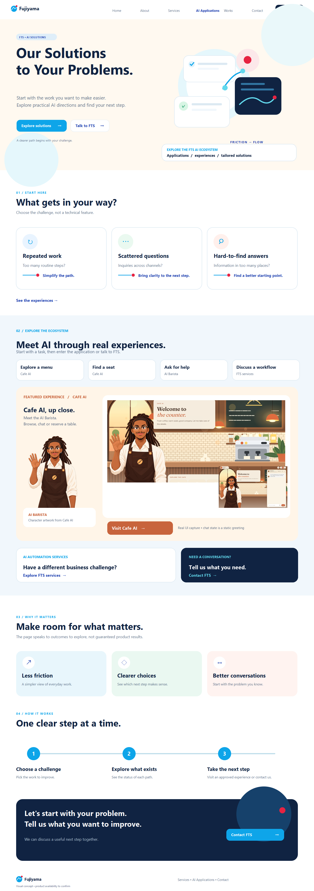
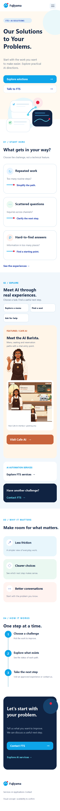
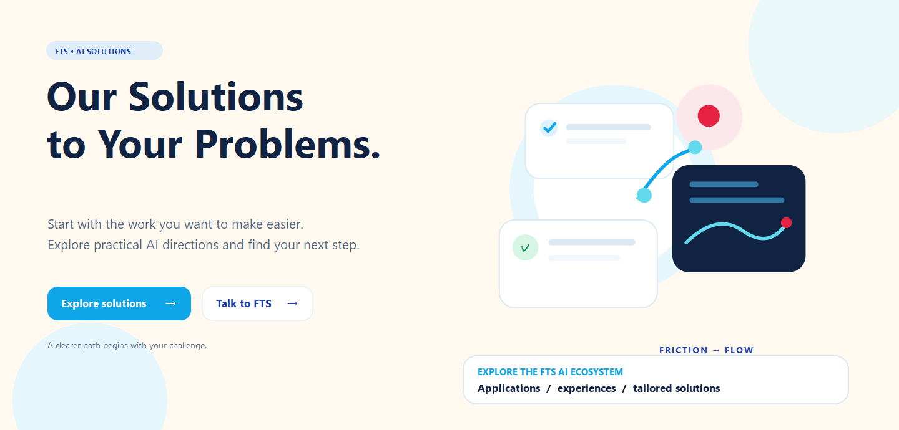
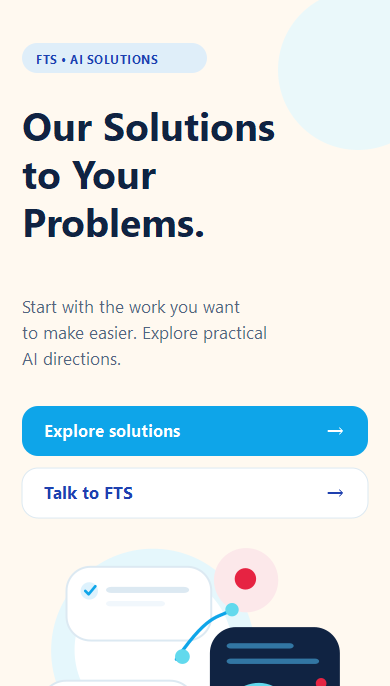
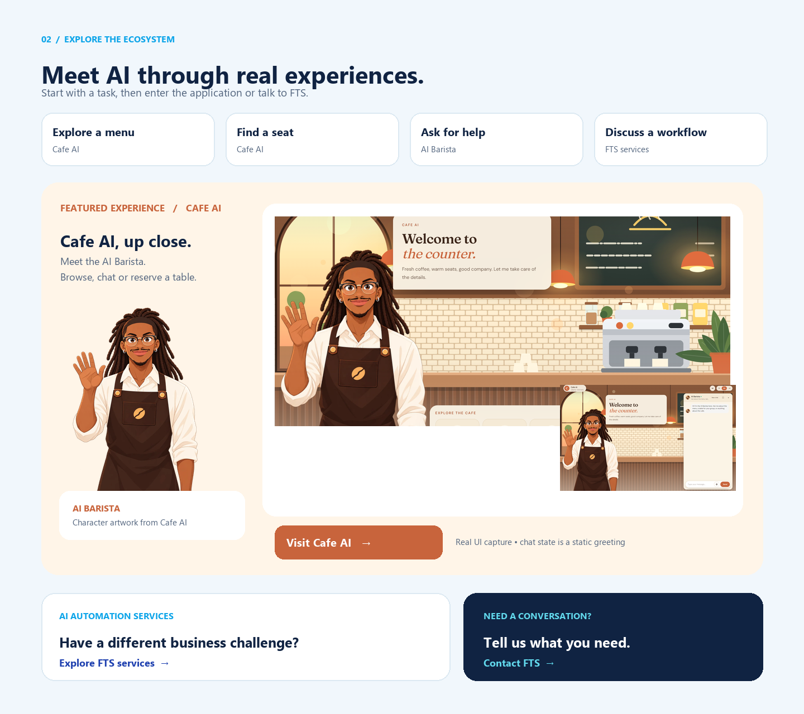
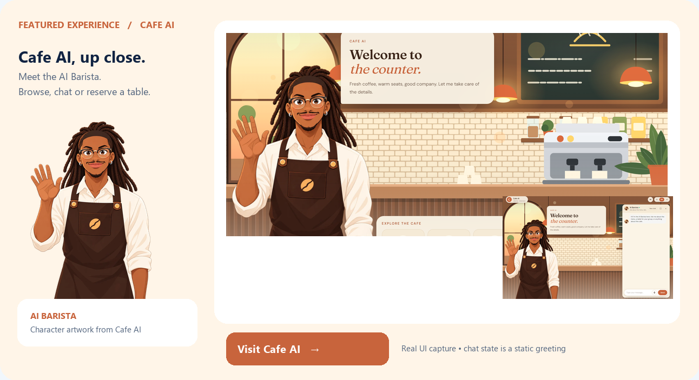
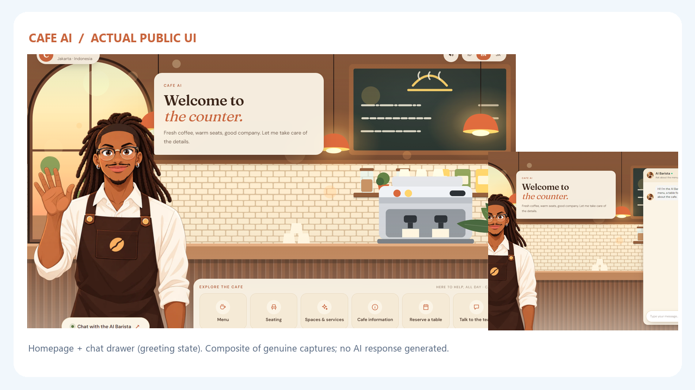
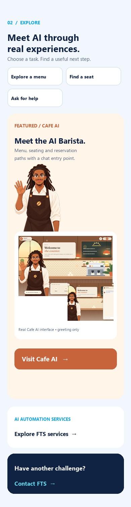

# Proposal Desain Visual FTS AI Landing Page — v2

**Untuk Mr. Yoshi / review visual · Untuk Mr. Miftah / handoff developer**  
**Pesan:** Our Solutions to Your Problems  
**Arah:** From Friction to Flow + pengalaman aplikasi yang human-centred  
**Dasar bukti:** Company-Profile-FE `main` @ `4ffb199f6889b32fe15181f7c3c92939283ece7b`; Cafe AI `main` @ `383692f82b0897be733cc01c9d63ebb33888e082` beserta **working tree lokal yang belum bersih**; situs live diperiksa 12 November 2026.

> Ini adalah **mockup desain**, bukan halaman FTS yang telah tayang. Karakter dan capture UI Cafe AI asli; penempatannya di layout FTS merupakan komposisi. Tidak ada hasil percakapan AI rekaan. Izin pemakaian visual dan redaksi final masih memerlukan persetujuan.

## Bagian A — Review visual

### Ringkasan eksekutif

Proposal awal sudah membangun alur FTS-biru “From Friction to Flow”, tetapi bagian showcase aplikasi terlalu menyerupai kartu produk generik. V2 mempertahankan pesan dari masalah pelanggan, hierarki desktop/mobile, hero kertas hangat, penutup navy dan design system responsive. Bagian tengah kini menjadi **ruang eksplorasi berdasarkan tugas**: pilih kebutuhan, temui karakter AI Barista asli pada panel khusus Cafe AI, lihat antarmuka asli, lalu masuk ke Cafe AI atau bicarakan masalah lain dengan FTS. Cafe AI adalah **salah satu contoh**, bukan seluruh identitas AI FTS. Halaman tetap biru, lapang, dan profesional; terracotta dan kertas cafe hanya tampil di area aplikasinya.

### Yang terverifikasi dari Cafe AI

Situs publik `https://cafe-ai.fts-tech.co.id/` menampilkan meja kafe terilustrasi dan karakter penyambut. Pada `/cafe-ai?lang=en` tersedia pintu masuk **Menu, Seating, Spaces & services, Cafe information, Reserve a table, Talk to the team**. Tombol “Chat with the AI Barista” membuka panel percakapan. Pada pemeriksaan live, panel memperlihatkan sapaan awal asli: “Hi! I'm the AI Barista here. Ask me about the menu, a table for your group, or anything about the cafe.” Kami **tidak mengirim pesan**, sehingga respons AI di produksi tidak diverifikasi. Route menu, detail item, tempat duduk, dan reservasi berhasil dibuka; formulir reservasi memiliki lima langkah dan menyatakan ketersediaan final dikonfirmasi oleh tim. Kontrol bahasa mengarah ke ID/EN/JA. Pada viewport 390 px, tile tugas dapat digeser mendatar dan chat terbuka mengisi sebagian besar layar.

Source lokal memakai **Laravel 13 + Blade/Vite**, bukan React Company-Profile-FE. `routes/web.php` dan `app/Http/Controllers/CafePageController.php` mengatur scene dan endpoint tamu; `resources/views/components/cafe-stage.blade.php` menyusun scene, Barista, navigasi tugas, dan chat. `config/cafe.php` memilih pose WebP Barista per scene. `resources/css/stage/tokens.css` mendefinisikan warna paper/terracotta/espresso/leaf dan scene fixed 100dvh; `resources/css/stage/responsive.css` membuat navigasi swipeable dan chat lebih besar di mobile. `resources/js/barista.js`/`resources/js/shared/api.js` mengirim pesan JSON ber-CSRF, memakai token percakapan tamu, dan mengizinkan browser speech recognition bila tersedia. `app/Modules/Conversation/Actions/ReplyToGuest.php` serta `app/Modules/Assistant/Tools/ToolRegistry.php` mengatur model/tools untuk knowledge, menu, seating, permintaan reservasi dan handover manusia; kualitas jawaban dan ketersediaan backend produksi **belum diuji**.

**Batas penting:** working tree Cafe AI memiliki perubahan pengguna, termasuk **simulator pesanan kopi yang belum di-commit**. Fitur itu **tidak** ditampilkan dalam mockup, tidak diasumsikan sudah tayang, dan bukan alat AI Barista. Kedua repository tidak diubah atau diuji runtime. FTS memiliki frontend `/fts-aiweb/` terpisah dan halaman *layanan* AI automation; keduanya tidak diubah labelnya menjadi produk live. myAI tetap demo UI dengan AI belum aktif menurut brief, bukan aplikasi live yang diiklankan.

### Arah visual dan moodboard

| Fondasi FTS | Inspirasi Cafe AI | Terjemahan di V2 |
|---|---|---|
| Logo resmi Fuji/sirkuit dan biru `#0EA5E9` | Karakter ramah sebagai pintu masuk pengalaman | Hero FTS tetap abstrak; **Barista asli hanya berada di fitur Cafe AI** |
| Bidang terang yang lapang dan CTA navy | Kertas hangat, terracotta, tile tugas membulat | Showcase dibingkai mist-blue FTS dengan inset krem/terracotta khusus Cafe AI |
| Masalah → pendekatan → aksi | Navigasi berdasar tugas, karakter, chat kontekstual | Kartu “Explore a menu / Find a seat / Ask for help / Discuss a workflow” sebelum UI asli |
| Copy Inggris yang ringkas | Interaksi scene dan pilihan bahasa | Copy menjelaskan perjalanan pengguna, bukan menjanjikan kemampuan model |

Hero tetap **“Our Solutions to Your Problems.”** V2 menambah penanda ekosistem yang halus, bukan memindahkan latar cafe ke hero korporat. Keseluruhan halaman tidak mengadopsi stage fixed-height atau skema espresso Cafe AI.

### Showcase aplikasi — perbaikan utama

**Sumber visual asli:** `assets/cafe-live-home-desktop.png`, `cafe-live-chat-desktop.png`, `cafe-live-chat-mobile.png`, `cafe-live-menu-desktop.png`, `cafe-live-reservation-desktop.png`, diambil langsung dari situs live; `barista-greeting.webp` dari project lokal Cafe AI hanya dipakai dalam komposisi. Screenshot sumber tetap tersedia untuk audit. Preview besar menggabungkan **dua keadaan nyata** (homepage dan drawer terbuka), bukan satu screenshot pada satu momen. CTA **Visit Cafe AI** menuju `https://cafe-ai.fts-tech.co.id/cafe-ai?lang=en`, URL publik yang telah dibuka. **Explore FTS services** menuju `/ai-automation-indonesia`; **Contact FTS** menuju `/contact`. Perpindahan ke situs lain harus jelas pada implementasi.

**Kartu tugas adalah konsep navigasi, bukan fitur aplikasi baru.** Tiga tugas Cafe AI terkait route/UI yang benar-benar diamati: menu, seating, pembuka chat. “Discuss a workflow” mengarah ke halaman layanan/kontak FTS, bukan kemampuan Cafe AI. Jika diwujudkan sebagai filter interaktif, state terpilih harus aksesibel dan setiap route divalidasi; tautan anchor biasa cukup untuk rilis awal. Tidak ada output AI yang ditulis ulang sebagai hasil live.

### Struktur halaman dan copy website

| Tujuan | Copy untuk pengunjung (Inggris) | Komposisi / CTA |
|---|---|---|
| Hero | “Our Solutions to Your Problems.” / “Start with the work you want to make easier. Explore practical AI directions and find your next step.” | Split 55/45; **Explore solutions** → `#solutions`; **Talk to FTS** → `/contact` |
| Masalah | “What gets in your way?” / “Choose the challenge, not a technical feature.” | Tiga kartu lama; **See the experiences** → `#experiences` |
| Aplikasi | “Meet AI through real experiences.” / “Start with a task, then enter the application or talk to FTS.” | Empat label tugas, Cafe AI unggulan, layanan/kontak FTS terpisah |
| Fitur Cafe AI | “Cafe AI, up close.” / “Meet the AI Barista. Browse, chat or reserve a table.” | Karakter asli dan capture homepage/chat; **Visit Cafe AI** → `/cafe-ai?lang=en` di domain Cafe AI |
| Manfaat | “Make room for what matters.” / Less friction / Clearer choices / Better conversations | Tiga tile FTS; tidak ada metrik rekaan |
| Langkah | “One clear step at a time.” / Choose a challenge / Explore what exists / Take the next step | Horizontal desktop, vertikal mobile |
| CTA akhir | “Let's start with your problem.” / “Contact FTS” | Panel navy ke `/contact` |

### Status dan batas klaim

- **Cafe AI:** scene publik, menu, seating, UI reservasi, sapaan awal chat dan navigasi **diamati**; kode workflow model/tools **ada**; jawaban AI live dan uptime backend **belum diverifikasi**. Jangan menjanjikan jawaban instan atau ketersediaan meja pasti.
- **FTS AI Automation:** informasi layanan yang ada, bukan kartu aplikasi baru.
- **myAI:** demo UI dan AI belum aktif menurut brief; tidak ditemukan implementasi di Company-Profile-FE. Tidak tampil di mockup V2.
- **Simulator pesanan kopi:** pekerjaan lokal Cafe AI yang belum di-commit; tidak dipastikan tersedia di situs publik dan dikeluarkan dari V2.
- **Hak visual:** capture UI asli merupakan bahan review; pemilik perlu menyetujui pemakaian screenshot dan karakter pada situs FTS.

## Bagian B — Handoff developer / Mr. Miftah

### Layout dan komponen

Bagian aplikasi baru disisipkan di antara problem dan benefits yang dipertahankan. Desktop 1440 px: margin sisi 74 px; intro section lebar penuh; empat tile tugas (~310 × 95 px), satu inset Cafe AI (~1292 × 703 px) dengan deskripsi/Barista di kiri dan capture UI nyata di kanan; di bawahnya dua jalur singkat: layanan dan kontak. Jangan menganggap empat tile sebagai empat produk—itu **tugas**, Cafe AI satu contoh aplikasi terverifikasi. Mobile 390 px: tile dua kolom, inset ~346 px dengan urutan copy → karakter → screenshot → CTA, lalu layanan/kontak bertumpuk. Uji 320 px supaya teks dan screenshot tidak terpotong.

Komponen semantik yang disarankan: `Navigation`, `Footer`, `Button`, SEO dan token tema yang ada; komponen lokal `TaskLink`, `FeaturedExperience`, `ExperienceStatus`, `ContactRoute` hanya jika dibutuhkan. Gunakan anchor biasa sebagai opsi paling sederhana. Gambar aplikasi bukan latar yang membawa teks penting. Alt Barista: “Cafe AI Barista character”; alt UI: “Cafe AI homepage and chat drawer with initial greeting”; garis FTS abstrak bersifat dekoratif. Jangan embed aplikasi Laravel Cafe AI atau menyalin CSS-nya ke React.

### Token, responsive dan motion

| Elemen | Panduan |
|---|---|
| Dasar FTS | `--primary`, `--primary-dark`, Inter, `max-w-6xl`/`px-4`, nav dan theme existing; jangan ubah token global demi mockup |
| Bidang V2 | Mist FTS `#F1F7FC`, navy `#102342`, krem `#FFF5E8` **hanya inset Cafe AI**, terracotta `#C8643C` hanya CTA/eyebrow cafe |
| Teks/jarak | Desktop H1 56–64, H2 36–44, body 17–19 px; mobile H1 36–40, H2 26–30, body 15–17; spacing 8 px; radius fitur 24–30 px |
| Breakpoint | ≥1024: empat tile dan inset 2 kolom; 640–1023: dua tile dan inset dapat ditumpuk; <640: dua/satu tile, inset satu kolom, CTA penuh |
| Interaksi | Hover tile naik 2–4 px, ring focus terlihat; tidak ada chat simulasi autoplay. Reveal 300–500 ms opsional, dinonaktifkan pada `prefers-reduced-motion` |
| Kontras | Teks navy pada bidang terang, cek kontras tombol putih/terracotta, teks biasa ≥4,5:1; dark mode disesuaikan tanpa mengubah warna screenshot cafe |

### Inventaris aset dan organisasi

| Aset di `v2/assets/` | Resolusi / kegunaan | Penanganan produksi |
|---|---|---|
| `desktop-full-v2.png` / `mobile-full-v2.png` | 1440×4074 / 390×5152; mockup utuh | Bahan review, bukan satu gambar datar sebagai halaman web |
| `hero-v2.png` / `hero-mobile-v2.png` | 1440×690 / 390×686 | Dekorasi dibuat ulang SVG/CSS, teks HTML semantik |
| `applications-v2.png` / `applications-mobile-v2.png` | 1440×1280 / 390×1500 | Panduan section, bukan layout raster untuk produksi |
| `cafe-showcase-v2.png` | 1292×703 | Pisahkan karakter asli dan screenshot asli |
| `cafe-interface-preview.png` | 1280×720, komposit **dua state asli** | Beri label komposit bila digunakan; jangan sebut satu state live |
| `cafe-live-*.png` | Capture sumber situs Cafe AI | Simpan untuk provenance; crop/optimasi setelah izin |

Direktori aset setelah approval: `public/images/ai-landing/global/` untuk motif FTS dan `public/images/ai-landing/apps/cafe-ai/` untuk ekspor karakter/UI berizin. SVG untuk garis FTS dan WebP teroptimasi untuk screenshot asli. Tidak perlu mengubah repository asal untuk menghasilkan proposal. Tautan Cafe AI memakai URL lengkap eksternal; kontak/layanan internal memakai React Router. Tidak perlu dependency baru ataupun chat palsu pada halaman FTS.

### Prioritas dan pemeriksaan akhir

1. **P0 approval pemilik:** pastikan relasi Cafe AI-FTS dan izin karakter/screenshot, URL yang dipilih, batas klaim produk, dan apakah ada aplikasi terverifikasi lain.
2. **P1 approval visual:** Mr. Yoshi menyetujui keseimbangan biru FTS vs inset cafe, hero desktop/mobile, label tugas dan komposisi karakter/UI.
3. **P1 implementasi Miftah nanti:** route/SEO, shell FTS, section semantik, anchor tugas, fitur responsive, aset berizin, tautan valid.
4. **P2 pemolesan:** focus keyboard, reduced motion, dark mode, gambar optimal dan alt deskriptif.
5. **P0 QA tayang:** cek URL live dan redaksi yang diperbolehkan, 320/390/768/1440 px serta hak visual. Dokumen ini tidak membuktikan kualitas jawaban AI di produksi.

**Kesimpulan:** V2 menjaga identitas FTS sambil memperlihatkan bagaimana pelanggan *benar-benar masuk* ke salah satu pengalaman AI. Cafe AI menjadi contoh konkret tanpa menjadikan seluruh halaman korporat seperti website kafe atau menciptakan katalog produk fiktif. Mockup ini artefak desain; publikasi menunggu persetujuan produk, hak visual dan copy.
