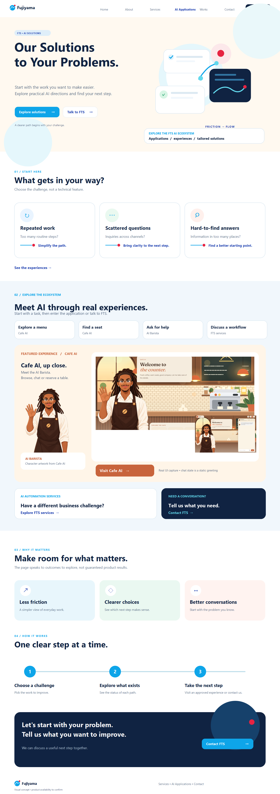
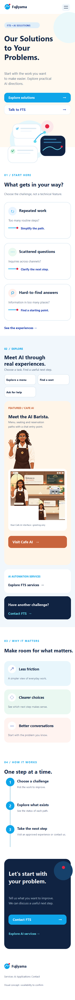
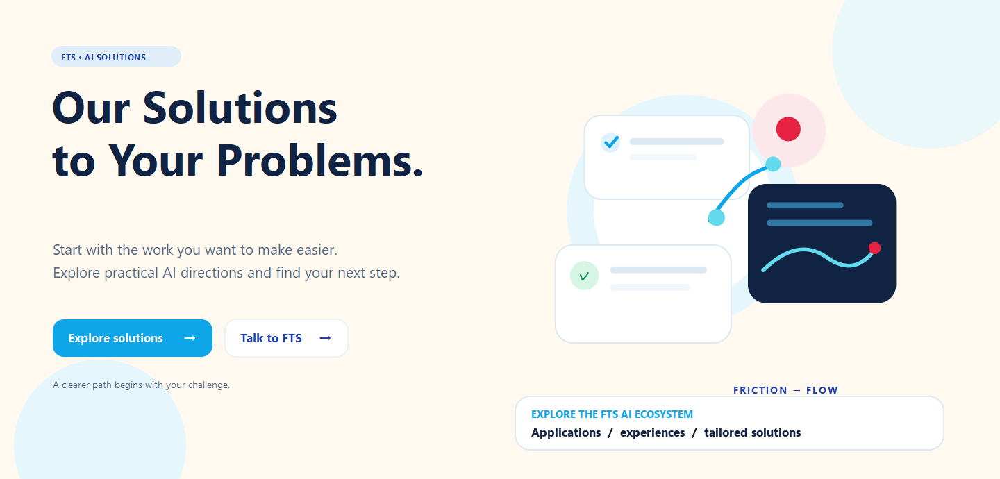
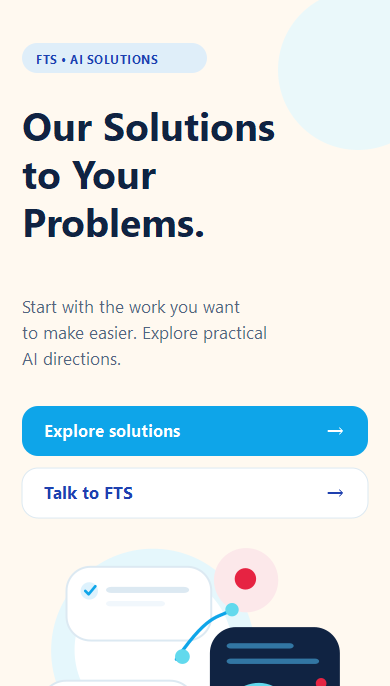
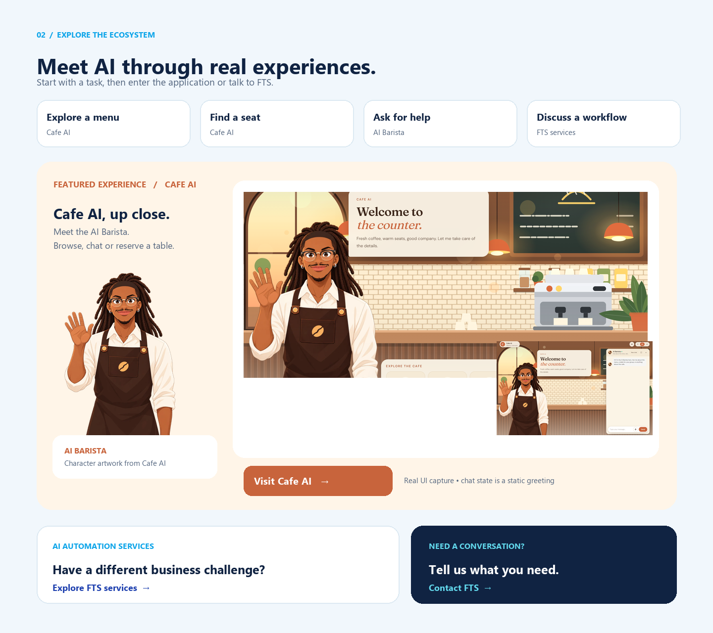
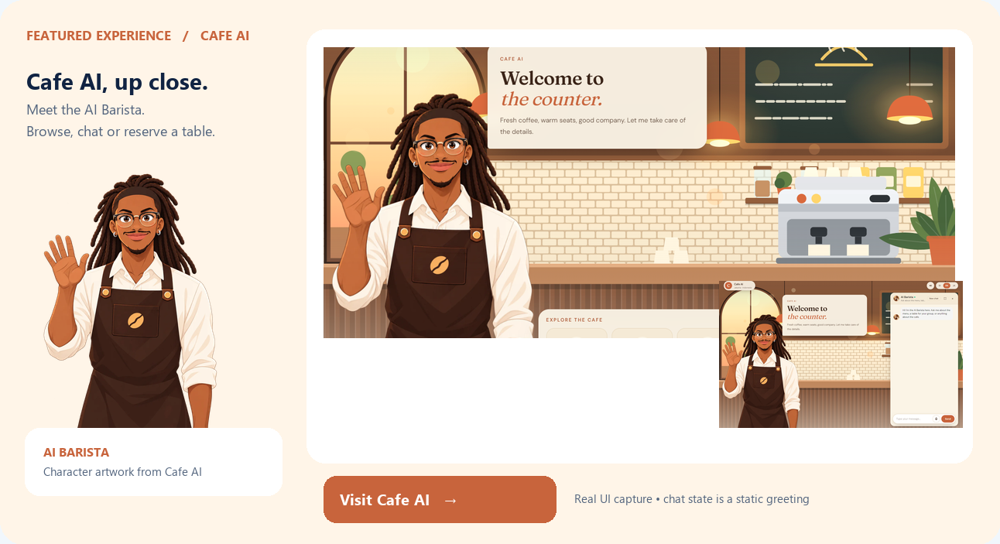
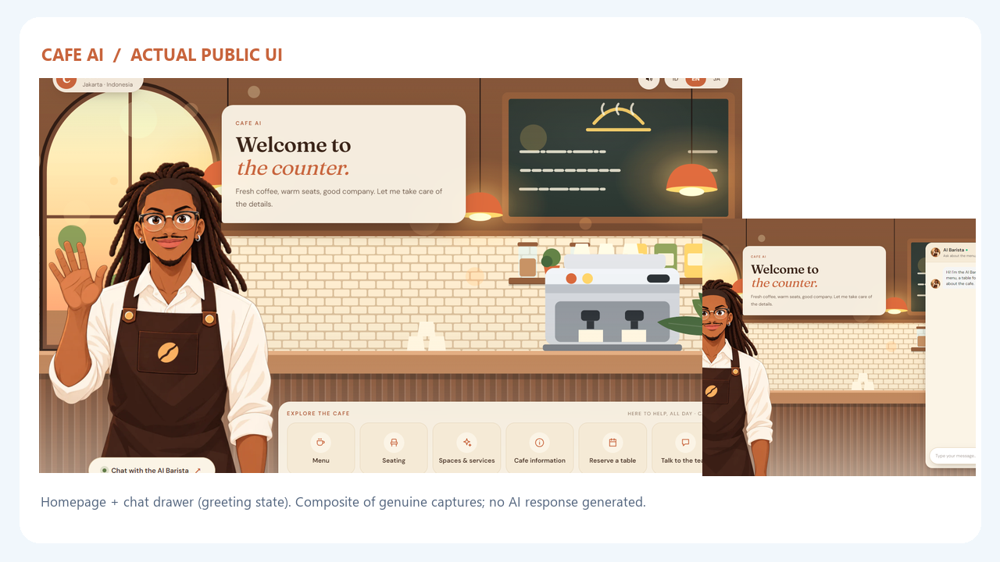
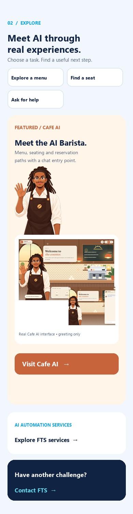

# FTS AI Landing Page — Visual Proposal v2

**For Mr. Yoshi / design review · For Mr. Miftah / developer handoff**  
**Message:** Our Solutions to Your Problems  
**Direction:** From Friction to Flow + human-centred application experience  
**Evidence:** Company-Profile-FE `main` @ `4ffb199f6889b32fe15181f7c3c92939283ece7b`; Cafe AI `main` @ `383692f82b0897be733cc01c9d63ebb33888e082` plus its **dirty local working tree**; live Cafe AI inspected 12 November 2026.

> These are **design mockups**, not a deployed FTS page. Cafe AI artwork and UI captures are genuine; their placement in the FTS layout is a composite. No generated conversation result is presented. Reuse rights and final publication wording still require approval.

## Part A — Visual design review

### Executive summary

The first proposal established a credible FTS-blue “From Friction to Flow” journey but treated the application showcase too much like a generic product card. V2 keeps the customer-first message, desktop/mobile hierarchy, warm paper hero, navy finish, and responsive design system. It now makes the middle of the page a **task-based exploration space**: choose a need, meet a real AI Barista character in an application-specific warm panel, see genuine Cafe AI interface states, then enter Cafe AI or discuss another challenge with FTS. Cafe AI is one example, **not** the identity of all FTS AI offerings. The overall page stays blue, spacious and corporate; terracotta and cafe paper live only within the Cafe AI feature.

### What we learned from Cafe AI — verified observation

The public site at `https://cafe-ai.fts-tech.co.id/` has an illustrated cafe counter and a character that welcomes the visitor. The live `/cafe-ai?lang=en` scene offers task entrances for **Menu, Seating, Spaces & services, Cafe information, Reserve a table, Talk to the team**. A visible “Chat with the AI Barista” button opens a conversation drawer. The live opening drawer showed only its authentic greeting: “Hi! I'm the AI Barista here. Ask me about the menu, a table for your group, or anything about the cafe.” We **did not send a message**, so production AI answers are not verified. Menu, item detail, seating and reservation routes were opened; reservation shows a five-step form and explicitly says final availability is confirmed by the team. Language controls link to ID, EN and JA. At a 390 px viewport, task tiles remain horizontally navigable and the open chat fills most of the screen.

The local source is **Laravel 13 + Blade/Vite**, not the React company site. `routes/web.php` and `app/Http/Controllers/CafePageController.php` define cafe scenes and guest endpoints; `resources/views/components/cafe-stage.blade.php` composes scene, barista, task navigation and chat. `config/cafe.php` assigns genuine WebP barista poses to scenes. `resources/css/stage/tokens.css` defines paper/terracotta/espresso/leaf colors and a fixed 100dvh scene; `resources/css/stage/responsive.css` makes navigation swipeable and chat larger on mobile. `resources/js/barista.js` and `resources/js/shared/api.js` send CSRF-protected messages, maintain a guest conversation token and support browser speech recognition where available. `app/Modules/Conversation/Actions/ReplyToGuest.php` and `app/Modules/Assistant/Tools/ToolRegistry.php` contain the model/tool workflow for knowledge, menu, seating, reservation requests and human handover; actual response quality and backend availability in production were not tested.

**Important boundary:** the local Cafe AI tree has user edits, including **uncommitted coffee-order simulator code**. It is **not** represented in these mockups, is not assumed deployed, and is not an AI Barista tool. We did not edit or test either repository. The FTS repository contains a separate `/fts-aiweb/` frontend and an AI-automation *service* page; neither is silently relabelled as another live product. myAI remains a brief-stated UI demo with inactive AI, not an advertised live app.

### Visual direction and moodboard

| FTS foundation | Cafe AI inspiration | V2 translation |
|---|---|---|
| Official Fuji/circuit logo and primary blue `#0EA5E9` | Friendly character as the entrance to an experience | Keep FTS hero abstract; place the **actual AI Barista only inside Cafe AI's feature** |
| Airy light sections and navy closing panel | Warm paper, terracotta and rounded task tiles | Showcase uses a mist-blue FTS frame with one cream/terracotta branded inset |
| Problem → approach → next step | Task-based navigation, character, contextual chat | “Explore a menu / Find a seat / Ask for help / Discuss a workflow” cards precede a genuine UI preview |
| Concise English website copy | Scene-based interaction and language choice | Copy describes the user journey rather than model claims; destination opens Cafe AI as a separate site |

The hero still says **“Our Solutions to Your Problems.”** V2 adds a subtle ecosystem cue, rather than transplanting cafe scenery into the corporate hero. The full page does not adopt Cafe AI's fixed-height scene design or espresso color scheme. It feels like FTS introducing a living example.

### The new application showcase — primary visual improvement

**The genuine visual sources** are `assets/cafe-live-home-desktop.png`, `cafe-live-chat-desktop.png`, `cafe-live-chat-mobile.png`, `cafe-live-menu-desktop.png`, `cafe-live-reservation-desktop.png`, captured directly from the public website; character `barista-greeting.webp` is used from the local Cafe AI project solely in the composite. The original screenshots are retained in `assets/` for auditing. The larger UI composition combines two real states (homepage and opened drawer); it is not one single screen at one moment. The mockup's CTA **Visit Cafe AI** goes to `https://cafe-ai.fts-tech.co.id/cafe-ai?lang=en`, a directly opened public URL. The corporate **Explore FTS services** goes to `/ai-automation-indonesia`; **Contact FTS** goes to `/contact`. On a future implementation, external-site transition should be clear, not silently presented as an internal route.

**Task cards are navigational concepts, not new application features.** Three cafe tasks map to real live routes/UI: menu, seating and chat entry. “Discuss a workflow” maps to the existing FTS service/contact path, not a purported Cafe AI function. If implemented as filters, their selected state must be accessible and every route verified; a simpler anchored link layout is acceptable for the first release. No AI output is fabricated or overlaid on the screenshots.

### Section map and visitor-facing copy

| Purpose | Suggested display copy | Composition / CTA |
|---|---|---|
| Hero — immediate relevance | “Our Solutions to Your Problems.” / “Start with the work you want to make easier. Explore practical AI directions and find your next step.” | 55/45 FTS illustration; **Explore solutions** → `#solutions`; **Talk to FTS** → `/contact` |
| Problems — self-identification | “What gets in your way?” / “Choose the challenge, not a technical feature.” | Three existing challenge→approach cards; link **See the experiences** → `#experiences` |
| Applications — task entry | “Meet AI through real experiences.” / “Start with a task, then enter the application or talk to FTS.” | Four task labels, one featured Cafe AI experience, distinct FTS service/contact cards |
| Cafe AI feature — real example | “Cafe AI, up close.” / “Meet the AI Barista. Browse, chat or reserve a table.” | Authentic character + genuine homepage/chat preview; **Visit Cafe AI** → public `/cafe-ai?lang=en` |
| Benefits — direction, not guarantee | “Make room for what matters.” / Less friction / Clearer choices / Better conversations | Three FTS-colored tiles; no fabricated metrics |
| How it works — next step | “One clear step at a time.” / Choose a challenge / Explore what exists / Take the next step | Horizontal desktop, vertical mobile; no setup-time promise |
| Closing — conversion | “Let's start with your problem.” / “Contact FTS” | Existing navy panel; contact route remains accessible even without a suitable application |

### Status and approval guardrails

- **Cafe AI**: public scene, menu, seating, reservation UI, greeting-only chat drawer and navigation **observed**; code for AI/tool workflow **present**; a live AI answer or backend uptime **not verified**. Avoid “instant answers,” “fully autonomous,” or guaranteed table availability.
- **FTS AI Automation**: existing service information, not another application card.
- **myAI**: per brief, UI demo with inactive AI; no implementation found in `Company-Profile-FE`. Not shown in V2 mockup.
- **Coffee-order simulator**: local uncommitted Cafe AI work; not confirmed on public site and excluded from V2.
- **Image provenance**: the genuine UI captures are review material. Owner must approve external publication and character/screenshot reuse in the FTS site.

## Part B — Developer handoff / Mr. Miftah

### Page layout and components

The new application area is inserted between the unchanged problem section and benefit section. Desktop at 1440 px: 74 px side margins; section intro full width; four task tiles in a row (~310 × 95 px each); a single featured Cafe AI inset (~1292 × 703 px) with left description/Barista and right real UI composite; below it two shorter routes, service and contact. Do **not** hard-code four application products; these are *tasks*, with Cafe AI as the one verified application example. At 390 px: two task tiles per row; featured inset ~346 px wide with copy → character → screenshot → CTA; service and contact stack below. Mobile full-page mockup shows actual section proportions; at 320 px check line wrap and avoid clipped screenshot content.

Recommended semantic building blocks: existing `Navigation`, `Footer`, `Button`, SEO and theme tokens; page-local `TaskLink`, `FeaturedExperience`, `ExperienceStatus`, `ContactRoute`. Keep interaction state simple; anchors are acceptable. App imagery and labels are not background-only content. Provide alt text for the Barista portrait (“Cafe AI Barista character”) and for genuine UI (“Cafe AI homepage and chat drawer with initial greeting”); mark abstract FTS lines decorative. Do not embed the whole Cafe AI application or copy its Laravel CSS into React.

### Tokens, responsive and motion

| Item | Guidance |
|---|---|
| FTS base | Existing CSS `--primary`, `--primary-dark`, Inter, `max-w-6xl`/`px-4`, existing navigation and theme; never edit global tokens merely to match the mockup |
| V2 section surfaces | FTS mist `#F1F7FC`, navy `#102342`, cream `#FFF5E8` **inside Cafe AI inset only**, Cafe terracotta `#C8643C` only for its CTA/eyebrow |
| Text/spacing | Desktop H1 56–64, H2 36–44, body 17–19 px; mobile H1 36–40, H2 26–30, body 15–17; 8 px base spacing; 24–30 px feature radii |
| Breakpoints | ≥1024: four task tiles and wide 2-column feature; 640–1023: two tiles, stack feature if needed; <640: two/one task tiles as width permits, single-column feature and full-width CTA |
| Interaction | Task hover 2–4 px, focus-visible ring; no autoplay chat simulation. Optional 300–500 ms section reveal, disabled for `prefers-reduced-motion` |
| Contrast | Navy text on light surfaces, verified white/terracotta button contrast, normal copy ≥4.5:1; review dark-mode alternatives without replacing Cafe-specific screenshot colors |

### Asset inventory and naming

| Asset in `v2/assets/` | Resolution / role | Production handling |
|---|---|---|
| `desktop-full-v2.png` / `mobile-full-v2.png` | 1440×4074 / 390×5152; full-page mockups | Review only, not a flat image to serve as a web page |
| `hero-v2.png` / `hero-mobile-v2.png` | 1440×690 / 390×686; updated hero | Recreate illustration as SVG/CSS, keep text in semantic HTML |
| `applications-v2.png` / `applications-mobile-v2.png` | 1440×1280 / 390×1500; task + showcase | Section specification, not rasterized production layout |
| `cafe-showcase-v2.png` | 1292×703; dedicated feature | Extract authentic assets and real screenshots separately |
| `cafe-interface-preview.png` | 1280×720; composite of **two actual UI states** | Label composite clearly if used; do not represent as a single live state |
| `cafe-live-*.png` | Source screenshots from public Cafe AI | Retained for provenance; optimize/crop only after owner approval |

Future implementation asset home: `public/images/ai-landing/global/` for FTS motif and `public/images/ai-landing/apps/cafe-ai/` for licensed barista/UI screenshot exports. Prefer WebP for genuine screenshots, SVG for global flow lines. Do not modify either source repo to generate these assets. Link the external Cafe AI site with its full approved URL; internal service/contact links remain React Router links. There is no need for a new dependency or a fake interactive chat component on the FTS page.

### Priorities and final checks

1. **P0 owner gate:** confirm Cafe AI affiliation and permission to reuse character/UI captures, preferred destination (`/cafe-ai?lang=en` versus homepage), product claims, and whether other verified applications belong beside it.
2. **P1 visual gate:** approve FTS-global versus Cafe-specific color balance, desktop/mobile hero, task labels and the character/screenshot composition with Mr. Yoshi.
3. **P1 implementation by Mr. Miftah later:** page route/SEO, FTS shell, semantic sections, task anchors, responsive feature, genuine approved assets, valid links.
4. **P2 polish:** keyboard focus, reduced motion, dark mode, optimized images and descriptive alt.
5. **P0 launch QA:** browser-test real URLs, Cafe AI readiness and actual allowed wording; inspect 320/390/768/1440 widths and permissions. Never claim production AI response quality from this document.

**Conclusion:** V2 retains the recognizable FTS frame while demonstrating how a customer *actually enters* one AI experience. The middle of the page now makes Cafe AI tangible without turning the entire corporate site into a cafe or inventing a product catalogue. The mockups are design artifacts; publication still depends on rights, product and copy approval.
